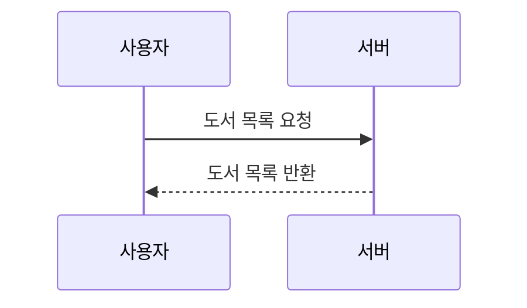

# Book Frontend 서비스 명세

## 개요

개인 도서 관리 웹 서비스. 도서 등록/조회/수정/삭제, 독서 기록, 메모, 통계 기능을 제공한다.

- **Tech Stack**: React 19, Vite, TanStack Query, React Router DOM, React Hook Form + Zod, Tailwind CSS, Axios
- **Markdown 뷰어**: react-markdown + remark-gfm + mermaid (Mermaid 코드 블록을 SVG 다이어그램으로 표시)
- **API Base URL**: `/api` (Vite 프록시 → `http://localhost:4000`)

---

## 주요 기능

### 인증 (Login / Signup)
- 이메일, 비밀번호 기반 회원가입
- 로그인 성공 시 사용자 정보를 전역 인증 상태에 저장
- 세션 기반 인증 유지 (`withCredentials: true`)
- 로그아웃 시 세션 종료 후 로그인 화면 또는 보호된 화면 접근 차단
- 비로그인 사용자가 보호된 화면 접근 시 로그인 후 원래 페이지로 이동 가능

#### 로그인 (Login)
- 입력 항목: 이메일, 비밀번호
- 두 항목 모두 필수 입력
- 로그인 요청 중에는 제출 버튼 비활성화 및 진행 상태 문구 표시
- 로그인 성공 시 `AuthContext`에 사용자 정보 저장
- 로그인 성공 후 기본 이동 경로는 `/books`
- 인증이 필요한 화면에서 로그인 페이지로 이동한 경우, 로그인 성공 후 원래 접근하려던 경로로 복귀
- 이메일 또는 비밀번호가 일치하지 않으면 오류 메시지 표시
- 기타 서버 오류 발생 시 서버 메시지 또는 기본 실패 메시지 표시

#### 회원가입 (Signup)
- 입력 항목: 이메일, 비밀번호
- 두 항목 모두 필수 입력
- 이메일 형식 1차 검증 후 요청 전송
- 가입 요청 중에는 제출 버튼 비활성화 및 진행 상태 문구 표시
- 회원가입 성공 시 로그인 화면(`/login`)으로 이동
- 중복 이메일 가입 시 오류 메시지 표시
- 기타 서버 오류 발생 시 서버 메시지 또는 기본 실패 메시지 표시

#### 인증 상태 관리
- 앱 최초 진입 시 `/api/auth/me` 호출로 로그인 여부 확인
- 인증 확인 전 `user` 상태는 `undefined`, 인증되지 않은 상태는 `null`로 관리
- 로그아웃 성공 시 전역 사용자 상태를 `null`로 초기화
- API 요청은 쿠키 기반 세션 인증을 사용하며 `withCredentials: true` 옵션을 적용

### 도서 목록 (BookList)
- 상태 탭 필터: 전체 / 소장 중 / 읽는 중 / 완독 / 읽기 제외 / 판매 / 기부
- 키워드 검색: 제목, 저자, ISBN
- 장르 필터
- 정렬: 등록일 / 제목 / 구입일 × 오름/내림차순

### 도서 등록/수정 (BookForm)
- 필수: 제목, 저자
- 선택: 출판사, ISBN, 장르, 상태, 구입일, 표지 이미지 URL
- 표지 이미지 URL 입력 시 미리보기 제공
- 유효성 검증: React Hook Form + Zod

### 도서 상세 (BookDetail)
- 도서 정보 표시 + 수정/삭제
- **독서 기록 탭**: 시작일, 종료일, 별점(1~5), 감상문 관리
- **메모 탭**: 내용, 페이지 번호 관리

### 통계 (Stats)
- 요약 카드: 전체 도서 수, 완독 수, 읽는 중 수, 평균 별점
- 월별 완독 수 (최근 12개월 막대 차트)
- 상태별/장르별/별점별 분포 차트

---

## 라우팅

| 경로 | 페이지 | 설명 |
|------|--------|------|
| `/login` | Login | 로그인 |
| `/signup` | Signup | 회원가입 |
| `/` | redirect | `/books`로 리다이렉트 |
| `/books` | BookList | 도서 목록 (검색, 필터, 정렬) |
| `/books/new` | BookForm | 도서 등록 |
| `/books/:id` | BookDetail | 도서 상세 + 독서기록/메모 탭 |
| `/books/:id/edit` | BookForm | 도서 수정 |
| `/stats` | Stats | 통계 대시보드 |

- `/books`, `/books/new`, `/books/:id`, `/books/:id/edit`, `/stats`는 인증 필요 화면으로 간주한다.
- 로그인 상태 확인은 앱 초기 진입 시 `/api/auth/me` 호출로 처리한다.

---

## API 엔드포인트

### 인증 (Auth)

| 메서드 | 경로 | 설명 | 요청 | 응답 |
|--------|------|------|------|------|
| POST | `/api/auth/signup` | 회원가입 | `{ email, password }` | `{ success, data: User }` |
| POST | `/api/auth/login` | 로그인 | `{ email, password }` | `{ success, data: User }` |
| POST | `/api/auth/logout` | 로그아웃 | - | `{ success, message }` |
| GET | `/api/auth/me` | 현재 로그인 사용자 조회 | - | `{ success, data: User }` |

### 도서 (Books)

| 메서드 | 경로 | 설명 | 요청 |
|--------|------|------|------|------|
| GET | `/api/books` | 도서 목록 조회 | query: `status`, `genre`, `search`, `sortBy`, `order`, `include` |
| GET | `/api/books/:id` | 도서 상세 조회 | - |
| POST | `/api/books` | 도서 등록 | `{ title, author, publisher?, isbn?, genre?, coverImageUrl?, purchaseDate?, status }` |
| PUT | `/api/books/:id` | 도서 수정 | 등록과 동일 (부분 허용) |
| DELETE | `/api/books/:id` | 도서 삭제 | - |

목록 조회 쿼리 파라미터:

| 파라미터 | 설명 | 기본값 |
|----------|------|--------|
| `status` | 도서 상태 필터 (`OWNED`, `SOLD`, `DONATED`) | - |
| `genre` | 장르 필터 | - |
| `search` | 제목 / 저자 / ISBN 검색 | - |
| `readStatus` | 독서 상태 필터 (`READ`, `EXCLUDED`, `NONE`) · `NONE`은 독서 기록이 없는 책(읽지 않은 책) | - |
| `userName` | 독서 기록의 독자 이름 필터 (`readStatus`와 함께 적용) | - |
| `sortBy` | 정렬 기준 컬럼 | `createdAt` |
| `order` | 정렬 방향 (`asc`, `desc`) | `desc` |
| `page` | 페이지 번호 | `1` |
| `limit` | 페이지당 항목 수 | `10` |

응답항목:

- `GET /api/books`
  `success`, `data`, `total`
  `data[]`: `id`, `title`, `author`, `publisher`, `isbn`, `genre`, `coverUrl`, `purchaseDate`, `status`, `createdAt`, `updatedAt`, `readingLogs`, `_count`
  `data[].readingLogs[]`: `readStatus`, `rating`, `startDate`, `endDate`, `userName`
  `data[]._count`: `memos`

- `GET /api/books/:id`
  `success`, `data`
  `data`: `id`, `title`, `author`, `publisher`, `isbn`, `genre`, `coverUrl`, `purchaseDate`, `status`, `createdAt`, `updatedAt`, `readingLogs`, `memos`
  `data.readingLogs[]`: `id`, `bookId`, `userName`, `readStatus`, `startDate`, `endDate`, `rating`, `review`, `createdAt`, `updatedAt`
  `data.memos[]`: `id`, `bookId`, `page`, `content`, `type`, `createdAt`, `updatedAt`

- `POST /api/books`
  `success`, `data`
  `data`: `id`, `title`, `author`, `publisher`, `isbn`, `genre`, `coverUrl`, `purchaseDate`, `status`, `createdAt`, `updatedAt`

- `PUT /api/books/:id`
  `success`, `data`
  `data`: `id`, `title`, `author`, `publisher`, `isbn`, `genre`, `coverUrl`, `purchaseDate`, `status`, `createdAt`, `updatedAt`

- `DELETE /api/books/:id`
  `success`, `message`

### 독서 기록 (reading-logs)

| 메서드 | 경로 | 설명 | 요청 | 응답 |
|--------|------|------|------|------|
| GET | `/api/books/:bookId/reading-logs` | 독서 기록 목록 | - | `{ data: Reading[] }` |
| POST | `/api/books/:bookId/reading-logs` | 독서 기록 추가 | `{ userName, startDate, endDate?, rating?, review? }` | `{ data: Reading }` |
| PUT | `/api/books/:bookId/reading-logs/:id` | 독서 기록 수정 | 추가와 동일 (부분 허용) | `{ data: Reading }` |
| DELETE | `/api/books/:bookId/reading-logs/:id` | 독서 기록 삭제 | - | - |

### 메모 (Memos)

| 메서드 | 경로 | 설명 | 요청 | 응답 |
|--------|------|------|------|------|
| GET | `/api/books/:bookId/memos` | 메모 목록 | - | `{ data: Memo[] }` |
| POST | `/api/books/:bookId/memos` | 메모 추가 | `{ content, page? }` | `{ data: Memo }` |
| PUT | `/api/books/:bookId/memos/:id` | 메모 수정 | `{ content?, page? }` | `{ data: Memo }` |
| DELETE | `/api/books/:bookId/memos/:id` | 메모 삭제 | - | - |

### 통계 (Stats)

| 메서드 | 경로 | 설명 | 응답 |
|--------|------|------|------|
| GET | `/api/stats` | 통계 조회 | `{ totalBooks, byStatus, byGenre, byMonth, avgRating, ratingDistribution }` |

---

## 데이터 모델

### User

```json
{
  "id": "number | string",
  "email": "string",
  "createdAt": "ISO-8601"
}
```

### Book

```json
{
  "id": "number",
  "title": "string",
  "author": "string",
  "publisher": "string | null",
  "isbn": "string | null",
  "genre": "string | null",
  "coverImageUrl": "string | null",
  "purchaseDate": "date-string | null",
  "status": "OWNED | SOLD | DONATED",
  "createdAt": "ISO-8601",
  "readStatus": "string | null"
}
```

### Reading

```json
{
  "id": "number",
  "bookId": "number",
  "userName": "string",
  "startDate": "date-string",
  "endDate": "date-string | null",
  "rating": "number (1~5) | null",
  "review": "string | null"
}
```

### Memo

```json
{
  "id": "number",
  "bookId": "number",
  "content": "string",
  "page": "number | null",
  "createdAt": "ISO-8601"
}
```

### Stats

```json
{
  "totalBooks": "number",
  "byStatus": { "OWNED": "number", "READING": "number", "DONE": "number", "...": "number" },
  "byGenre": { "소설": "number", "자기계발": "number", "...": "number" },
  "byMonth": { "YYYY-MM": "number" },
  "avgRating": "number",
  "ratingDistribution": { "1": "number", "2": "number", "3": "number", "4": "number", "5": "number" }
}
```

## 상태 코드

| 코드 | 레이블 |
|------|--------|
| `OWNED` | 소장 중 |
| `SOLD` | 판매 |
| `DONATED` | 기부 |

### 문서 게시판

- 상단 `내 서재` 우측의 `게시판` 링크로 이동한다.
- `/board`: 문서 목록. 전체/AI/관리/설계/기타 카테고리 필터와 10개 단위 페이지 이동을 제공한다. 필터와 페이지는 URL에 유지된다.
- 로그인 사용자에게 목록의 각 제목 오른쪽 `문서 삭제` 버튼을 제공한다. 확인 후 `DELETE /api/mkbrd/:id`로 삭제하며 처리 중 중복 요청을 막는다. 성공 시 목록·전체 건수를 갱신하고 마지막 페이지가 비면 이전 유효 페이지로 이동한다. 실패 시 오류를 표시한다.
- `/board/:id`: 공개 문서 상세. Markdown 제목, 표, 목록, 체크리스트, 코드 블록 등을 렌더링한다. HTML을 직접 실행하지 않고 위험한 링크 프로토콜을 차단한다.
- `/board/new`, `/board/:id/edit`: 로그인 사용자에게 등록·수정 화면을 제공한다. 비로그인 접근 시 로그인 후 원래 화면으로 복귀한다. 모든 로그인 사용자가 문서를 수정할 수 있다.
- 입력 항목은 카테고리, `.md` 파일 한 개와 선택적인 이미지 ZIP 한 개이다. 업로드 원본 파일명이 제목이 되며 별도 제목·본문 입력은 제공하지 않는다. 빈 파일도 허용한다. 등록·수정 화면에서 UTF-8 Markdown 파일을 선택해 업로드한다.
- 파일명은 최대 240 UTF-8 바이트이고 경로 문자, 제어 문자, 선행 마침표, Windows 예약 파일명을 제한한다. 파일 크기는 최대 10MB(10,485,760바이트)이며 UTF-8 및 NUL 문자 유무를 검증한다. MIME type은 제한하지 않는다. 원본 파일을 FormData의 `file` 필드로 전송하고 텍스트 필드는 `category`만 사용한다. Content-Type과 boundary는 브라우저가 생성한다. 수정 시 Markdown 파일을 생략하면 기존 문서 내용을 유지한다. 중복 파일명 등 서버 오류는 폼에 표시하며 입력을 유지한다.
- API: `GET /api/mkbrd`, `GET /api/mkbrd/:id`, `POST /api/mkbrd`, `PUT /api/mkbrd/:id`. 세션 쿠키를 전송한다. 저장 후 목록과 상세 캐시를 갱신하고 상세 화면으로 이동한다.
- 백엔드 설정 및 운영은 `../bookbackend/docs/mkbrd-api.md`를 따른다. 실행 중인 백엔드에서 해당 경로를 제공해야 한다.

- 이미지 첨부: 등록·수정에서 선택적으로 ZIP 한 개를 `images` 필드로 전송한다. Markdown과 ZIP은 각각 최대 10MB이며, ZIP은 이미지 파일만 포함해야 한다. 압축 내부 검증과 압축 해제(최대 100MB, 항목 1,000개)는 서버가 수행한다.
- 수정 시 ZIP 첨부는 기존 이미지 전체 교체이며 미첨부는 유지한다. 빈 ZIP을 첨부하면 이미지를 모두 비운다. Markdown 없이 ZIP만 교체할 수도 있다. 삭제 확인에는 첨부 이미지도 함께 삭제됨을 안내하고 DELETE 요청에는 첨부를 보내지 않는다.
- 상세 뷰어는 Markdown의 `image/도표/구성.png` 또는 `./image/도표/구성.png`를 상세 API의 `imageBaseUrl` 아래 URL로 변환한다. 한글·공백 및 기존 퍼센트 인코딩을 처리하며 하위 폴더를 지원한다. 이미지와 하위 폴더는 ZIP 루트에 배치한다.

#### Mermaid 다이어그램

- Markdown 코드 블록 시작의 백틱 3개 뒤에 소문자 `mermaid`를 지정하면 다이어그램으로 표시한다. 시작 구분자와 끝 구분자는 각각 별도 줄에 작성한다.
- 흐름도(`flowchart`), 시퀀스 다이어그램(`sequenceDiagram`) 등 설치된 Mermaid 라이브러리가 지원하는 문법을 사용한다. 언어가 `mermaid`가 아닌 코드 블록은 기존 코드 표시를 유지한다.
- 라이브러리는 Mermaid 블록이 있을 때 동적으로 불러오며, 브라우저에서 SVG로 렌더링한다. 별도 서버 변환이나 이미지 첨부는 필요하지 않다.
- 렌더링 중에는 `다이어그램을 불러오는 중입니다.`를 표시하고, 본문 내 Mermaid 소스가 변경되면 다시 렌더링한다.
- 로딩 또는 렌더링 실패 시 해당 블록에 `다이어그램을 표시하지 못했습니다. Mermaid 문법을 확인해주세요.`를 표시한다. `오류 상세 및 원문 보기`를 펼치면 오류 메시지와 입력 소스를 확인할 수 있다.
- 큰 다이어그램은 가로 스크롤로 확인한다.
- Mermaid는 `securityLevel: 'strict'`로 초기화하며, 자동 DOM 렌더링과 Mermaid 기본 오류 다이어그램 표시를 비활성화한다. 일반 Markdown의 HTML 및 링크 처리 정책은 유지한다.

작성 예시:

````markdown



````
